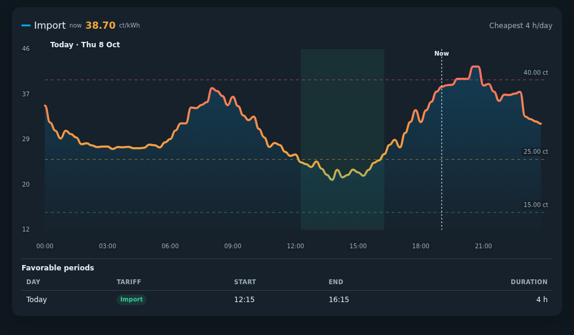

# Eleven Cards

Compact, configurable Home Assistant dashboard cards for energy prices and sensor history.

Each card works independently. They display existing Home Assistant data; they do not supply tariffs, create sensors, or control devices.

## Cards

| Card | Purpose | Documentation |
| --- | --- | --- |
| Eleven Dynamic Energy Price Card | Compare import/export prices, find favorable periods, and optionally overlay recorded grid-import energy. | [Installation and configuration](cards/dynamic-energy-price-card/README.md) |
| Eleven History Graph Card | Compare recorded values from 1–8 numeric sensors with the same unit. | [Installation and configuration](cards/history-graph-card/README.md) |




## HACS installation

The repository is intentionally private for review. HACS only supports public repositories, so this installation route becomes available only after the owner makes it public. It is not listed in the default HACS store.

Once public:

1. In HACS, open the menu and choose **Custom repositories**.
2. Add `https://github.com/hidder11/eleven-cards` with type **Dashboard**.
3. Download **Eleven Cards**. Both cards are included in one module.
4. Check dashboard resources for `/hacsfiles/eleven-cards/eleven-cards.js` with type **JavaScript module**. Add it only if HACS has not registered it automatically.
5. Refresh the browser. Both Eleven cards are available in the card picker.

HACS uses the root `hacs.json` and `dist/eleven-cards.js`. No release is required: until releases are published, the default branch supplies the package. When publishing a release later, attach that same `eleven-cards.js` as an asset.

For a manual collection installation, copy `dist/eleven-cards.js` to `/config/www/eleven-cards/eleven-cards.js` and register `/local/eleven-cards/eleven-cards.js` as a JavaScript module instead. Standalone per-card modules remain available below, but do not keep them registered alongside the collection module.

## Start here

1. Choose a card and check its sensor requirements.
2. Build and install its Eleven-prefixed module using its README.
3. Add the card using the new YAML type.
4. Use Home Assistant's native visual editor for customization.

Both cards follow the frontend language automatically (Dutch or English), inherit light/dark theme colors, support touch and keyboard inspection, and provide native Sections resizing. Card picker names retain the Eleven brand in both languages; chart titles and descriptions remain localized. Explicit user titles are unchanged.

## Runtime names

| Card | YAML type | Built module |
| --- | --- | --- |
| Energy prices | `custom:eleven-dynamic-energy-price-card` | `cards/dynamic-energy-price-card/dist/eleven-dynamic-energy-price-card.js` |
| History | `custom:eleven-history-graph-card` | `cards/history-graph-card/dist/eleven-history-graph-card.js` |

The Eleven builds register only these new custom-element types, not aliases for the old types.

## Migrating existing dashboards

This is a breaking type/resource rename. Installing a new module alone does not migrate saved cards.

1. Back up the dashboard configuration and current resource list.
2. Build and install the desired Eleven module alongside the old resource temporarily.
3. Change each intended instance from `custom:dynamic-energy-price-card` to `custom:eleven-dynamic-energy-price-card`, or from `custom:history-graph-card` to `custom:eleven-history-graph-card`.
4. Leave entities, titles, colors, sizing and every other configuration key unchanged.
5. Reload the browser and verify all migrated instances.
6. Remove the old resource only after no dashboard still uses its old type. Do not overwrite HACS-managed files manually.

The old and new types are distinct, so a temporary migration overlap is possible. Do not register a second copy of the same Eleven module. Duplicate-load protection is tested, but duplicate resources remain unnecessary.

## Build and test

Node 20+, npm and Python 3 are required. No npm dependencies need installing.

From this repository root:

```sh
npm run build
npm test
npm run check
```

The build produces two independent JavaScript modules plus the self-contained HACS collection module `dist/eleven-cards.js`. Source and regression tests live under each card directory; root tests cover branding, HACS packaging and both modules loading together. Edit source, not generated bundles.

### Shared graph

Both cards use `shared/graph.js` for the SVG surface, series lines/fills, non-scaling strokes, round markers and the one-time 650 ms clipped entrance animation. Each independent build embeds that same source; there is no extra runtime resource to install. Reduced motion disables the reveal, and an early rerender resumes it rather than replaying it.

Card adapters still own data loading, path geometry, gradients, axes, annotations and interactions. Tariffs, favorable periods, price thresholds and consumption remain energy-only. History retains recorder-held steps and true unavailable gaps; its default line width is now 3.5 px, with the same solid/dashed/dotted rhythm and caps as energy. Explicit line widths, the sensor palette and fill-off default remain supported.

Repeatable isolated browser QA (synthetic data, not a live dashboard):

```sh
uv run --with playwright --with pillow python tests/browser-shared-graph.py
```

The script currently uses the installed Chromium headless shell at `/opt/hermes/.playwright/chromium_headless_shell-1243/chrome-headless-shell-linux64/chrome-headless-shell` and the immutable pre-refactor backup at `/opt/data/cache/scratch/eleven-shared-graph-baseline`. Adjust those paths if reproducing elsewhere. It serves repository bytes through Playwright routing, with no listening server or Home Assistant requests. Results and baseline/after screenshots are under `qa-evidence/shared-graph/`. The shared-graph changes are built locally only; they have not been published or deployed.

## Repository status

The collection includes card sources, tests, QA fixtures, documentation and separately built Eleven modules. The original standalone source projects are unchanged.

Local installation has been tested separately. Private dashboard configurations and deployment evidence are intentionally not included.

The collection now has a root HACS manifest and a self-contained `dist/eleven-cards.js` module. The build retains the two standalone modules for manual installation and migration. No card configuration or runtime type has changed.

The repository remains private for owner review. The package is prepared for HACS custom-repository installation once it becomes public; it has not been installed through HACS or added to the default store. No collection release has been published.
